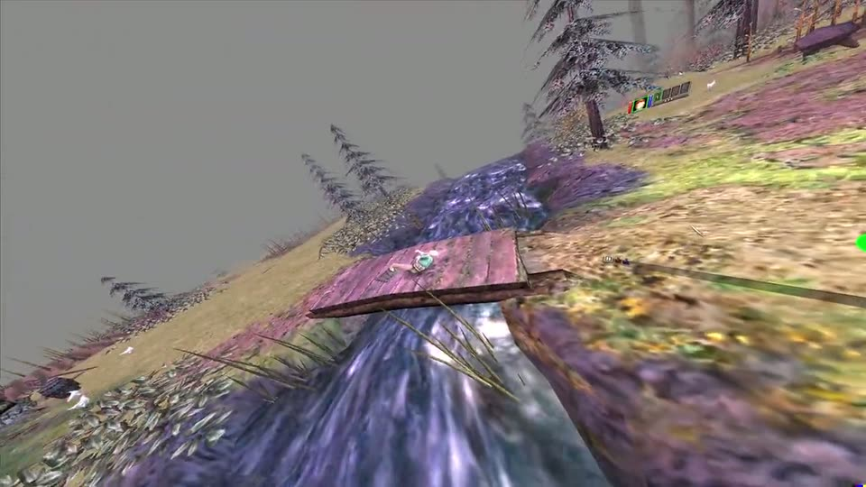

# dsvr — Dungeon Siege VR

Mod to play Dungeon Siege 1 (Steam, v1.11.1.1486) on a Valve Index via SteamVR.

<video src="docs/media/demo.mp4" poster="docs/media/demo-poster.jpg" controls muted width="960">
  <a href="docs/media/demo.mp4"></a>
</video>

- [docs/PLAN.md](docs/PLAN.md) — architecture and milestones
- [docs/EXE-ANALYSIS.md](docs/EXE-ANALYSIS.md) — static analysis of `DungeonSiege.exe` (evidence)
- [tools/re/](tools/re) — PowerShell scripts that reproduce the analysis
- [docs/media/demo.mp4](docs/media/demo.mp4) — demo: the monitor preview while playing in the headset (720p, 67 s)

## Build

Requires Visual Studio 2022 Build Tools with the C++ workload.

```powershell
.\init.ps1             # once: fetches OpenVR + dgVoodoo2 into third_party/ (SHA-256 verified)
.\build.ps1            # -> build\Release\version.dll (32-bit)
```

## Install

```powershell
.\deploy.ps1             # copies version.dll + dgVoodoo2 (DDraw.dll, D3DImm.dll, dgVoodoo.conf) into the game folder
.\deploy.ps1 -Uninstall  # removes them again
```

`dsvr.log` appears in the game folder.
The dgVoodoo config we ship is tracked in `deploy/dgVoodoo.conf`.

## License and legal

The mod's own code is under the [MIT License](LICENSE). It covers only this repository, not the game or the
third-party tools in `third_party/` (each keeps its own license).

You need your own legally obtained copy of Dungeon Siege. This repository contains no game code, assets or data:
the addresses and function names in the source and `docs/` describe where to hook into your installed
`DungeonSiege.exe`. This is an unofficial fan project, not affiliated with or endorsed by Gas Powered Games,
Microsoft or Square Enix; Dungeon Siege is a trademark of its respective owner.
